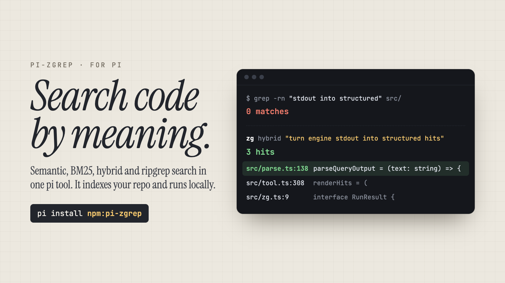

# pi-zgrep

Semantic code search for the [pi](https://github.com/earendil-works/pi-coding-agent) coding agent. One tool, four routes (hybrid, BM25, vector, ripgrep), auto-indexed.

[](https://www.npmjs.com/package/pi-zgrep) [](https://www.npmjs.com/package/pi-zgrep) [](https://github.com/carvalab/pi-zgrep/actions/workflows/ci.yml) [](./LICENSE) [](https://nodejs.org)



## What your agent gets

- It finds code by meaning. "Where do we parse the upstream output format?" works before anyone knows the symbol names, which is exactly an agent's situation in an unfamiliar repo.
- No setup and no daemon babysitting. The search engine installs as a dependency, the index builds in the background at session start, and a daemon keeps it fresh.
- Exact matching keeps an escape route: `mode=rg` passes the query to managed ripgrep and skips the index.

This is what that looks like on this repository. The agent makes one tool call:

```
zg({ query: "how does the extension avoid hanging when the child process exits", mode: "hybrid", glob: "*.ts", limit: 3 })
```

and gets ranked `file:line` hits back. This is that call's result on this repository, verbatim — one line per hit: `file:range`, two spaces, the first preview line (`--preview short`; the engine windows long preview lines, which is why the third hit starts mid-word).

```
src/index.ts:428-440  awaitChild = async (child: ChildProcess): Promise<number> => {
src/args.ts:141-151  resolveNewIndexEmbedding = (
src/zg.ts:19-63  o JS entry, so a plain global
```

The top hit is the answer, and none of the question's words is an identifier in the code: ripgrep, handed that sentence, finds only this repo's benchmark question list, never `awaitChild`. Questions phrased in their own vocabulary are where the index pays for itself; see [Benchmarks](#benchmarks) for the measured numbers.

## What's new in 0.7

- This release needs zg 0.3.0, the native Rust engine with an rg-style command line. An older binary is refused by name, with its path and version, instead of being handed flags it would read as search text.
- The engine is a normal npm dependency again. The per-platform package carries the binary and a checksum, so installs that block scripts keep working: npm 12's default and `npm install --ignore-scripts` both leave search working.
- `PI_ZG_BIN` is exclusive. When you set it, it is the only candidate: a missing, non-executable, stub, or too-old file gets one error and no silent fallback.
- The first index of a workspace names its embedding model, so a cold start no longer fails with `ZG.ENGINE.NOT_FOUND`.

## What's new in 0.6

- Each repository searches its own index. zg looks for an index in the current folder and then in each parent folder, so an index left in a parent folder (say `~/Dev`) used to capture every repo below it: the status said ready and semantic queries returned the parent's files. Now a repo inside an indexed parent gets its own index on first use.
- Session start no longer builds an index of your home directory or the filesystem root. Use `mode=rg` there, or `/zg-index` if you really want one.
- The tool appears in pi's "Available tools" list, and its routing advice rides on pi's tool guidelines. The old hook that replaced the whole system prompt each turn is gone.
- Function hits no longer break parsing. zg 0.2.2 prints an `outline:` section (with a blank line and a `calls:` list) for code symbols, and the parser used to give up and return the whole result as raw text. It now reads each hit up to the next one.
- Results render in the TUI: the call shows mode and query, the result shows the hit count and `file:line` list, with snippets when expanded.
- Large output follows pi's convention: capped at 2000 lines / 50KB, long lines cut to 500 characters, and the full text saved to a temp file the model can read.
- Zero results say "No matches" with a next step instead of an empty string, and a full page says the limit was reached.
- Common argument slips no longer cost a retry: `limit: "5"`, `mode: "semantic"` or `"grep"`, `null` optionals, `pattern` instead of `query`.
- The tool is marked read-only, so permission extensions don't ask before every search, and it returns `structuredContent` for codemode scripts.

## Install

```bash
pi install npm:pi-zgrep
```

Try it without installing: `pi -e npm:pi-zgrep`.

The engine, [zvec-grep](https://github.com/zvec-ai/zvec-grep) 0.3.0 (Apache-2.0, npm `@zvec/zvec-grep`), ships as a regular npm dependency, so one install brings both. zg 0.3.0 is a native Rust binary delivered by per-platform packages (`@zvec/zvec-grep-<os>-<arch>[-<libc>]`) listed as optional dependencies, so no lifecycle script is needed: **installs that block scripts work**. npm 12's default (RFC 0054) and `npm install --ignore-scripts` both leave search working, because the platform package already carries the binary. The one install that breaks is `--omit=optional` (including `npm ci --omit=optional`, or any pnpm/yarn setting that drops optional deps): the platform package never lands and the tool reports `@zvec/zvec-grep-linux-x64-gnu is not installed (optional dependency omitted?)`. Reinstall without that flag — `npm install @zvec/zvec-grep` — or set `PI_ZG_BIN` to a zg ≥ 0.3.0 binary you installed yourself.

### Which binary runs

1. `PI_ZG_BIN`, when set, is **exclusive**. It is the only candidate; if it is missing, not executable, the unmaterialized install stub, or older than 0.3.0, you get one error naming the variable, the path and the version found. There is no fallback.
2. Otherwise the bundled platform package: `@zvec/zvec-grep-<os>-<arch>[-<libc>]` selected through `platforms.json`, with its `bin/zg` verified against the shipped `checksums.json` (byte length plus sha256) before anything is spawned.
3. Otherwise a materialized `@zvec/zvec-grep/bin/zg.exe` — but only when it really is a native executable (ELF/PE/Mach-O magic). The placeholder stub is rejected by name.
4. Otherwise `zg` on PATH, gated on `zg --version`: anything below 0.3.0 is skipped and named in the error (`no usable zg binary: <path> (0.2.1 — zg 0.3.0 or newer is required)`) instead of being handed flags it would read as search text.

pi-zgrep itself is an integrator: the search logic lives upstream, and this package translates a pi tool call into `zg` argv and parses the output.

### Already have zg installed?

| situation | what happens |
| --- | --- |
| bundled engine only, no `zg` on PATH | bundled 0.3.0 runs; index plus all four routes work |
| bundled + a `zg` 0.2.1 first on PATH | bundled 0.3.0 wins; the 0.2.1 binary is never executed |
| bundled + a `zg` 0.3.0 first on PATH | bundled still wins (preference order); the PATH copy is used only when no platform package resolves |
| `PI_ZG_BIN` → 0.3.0 | that path only; bundled and PATH are never probed |
| `PI_ZG_BIN` → 0.2.1, missing, or the install stub | the tool returns `PI_ZG_BIN=<path> is set but zg is not usable there…` plus the per-candidate reason; no fallback, no index written |
| optional dependencies omitted | no binary at all; the resolver names the missing platform package and the tool error appends the reinstall hint |

Upgrading from 0.2.x needs no action. A 0.2.x `.zvec-grep` directory has no manifest for the current index schema, so `--status --check-ready` exits 1 and reports `Unavailable (rebuild required)`; the first index, warmup or tool call then rebuilds once with `--index --rebuild`. A leftover 0.2.x daemon records no `daemonProtocolVersion`, so the first session's `zg --server on` replaces it in place — or run `/zg-server on` to do it immediately.

On a workspace's first build the extension names the model for you (unless you pass `--embedding` yourself): `ZVEC_GREP_EMBEDDING` when set, else `PI_ZG_EMBEDDING`, else `local/potion-code-16m-v2`, local and code-tuned, downloaded once into the model cache (an offline first build fails). Existing indexes keep the model they were built with. A `--rebuild`, including the one-time 0.2.x rebuild, names no model, so zg picks it from `ZVEC_GREP_EMBEDDING`, its own config, or its default; `PI_ZG_EMBEDDING` does not apply there.

### Not upstream's `zg --install` integration

zg 0.3.0 ships its own Pi integration behind `zg --install`, which registers zg's search tools directly and writes your client config. pi-zgrep is a different layer: one `zg` tool, argv built and output parsed here, plus `/zg-index`, `/zg-status`, `/zg-server`, session warmup and the system-prompt nudge. Don't run both against the same pi — you get duplicate search tools and two daemons contending for one home. Pick one.

## The `zg` tool

Local-first semantic + BM25 + hybrid + ripgrep search over the current workspace.

| Parameter | Type | Default | Notes |
| --- | --- | --- | --- |
| `query` | string | (required) | Natural language, symbol, or regex (for `mode=rg`). |
| `mode` | `hybrid` \| `fts` \| `vector` \| `rg` | `hybrid` | Search route, sent as `--hybrid`/`--fts`/`--vector`/`--rg`. `rg` skips the index entirely. |
| `limit` | number (1-50) | `10` | Max results to return. |
| `glob` | string |  | File filter, e.g. `*.ts`. Must not start with `-`; use `!pattern` to exclude. |
| `type` | string |  | File-type filter. |
| `refresh` | `auto` \| `wait` | `auto` | `wait` forces `--refresh wait` after editing a file in the same session. Ignored for `mode=rg`. |
| `preview` | `short` \| `none` | `short` | Include a one-line code preview per result. Ignored for `mode=rg`. |

Results come back as ranked `file:line  score  first-preview-line` lines. Zero results return `No matches (mode=…)` with a suggested next route, and a page that fills `limit` says so. Output is capped the way pi's own tools cap it (2000 lines or 50KB, 500 characters per line); when anything is cut, the full text is saved to a temp file and the result names it.

Before validation the tool repairs common argument slips: numeric strings and out-of-range values for `limit` (clamped to 1-50), mode synonyms such as `semantic` → `vector`, `bm25` → `fts`, `grep`/`ripgrep` → `rg`, `null` or empty optionals, and `pattern` or `q` in place of `query`.

For programs, the result carries `structuredContent` (`{ results: [{ file, lineStart, lineEnd?, score?, snippet? }], truncated, raw? }`, declared as the tool's `outputSchema`), and `details` holds the same results for the TUI renderer. The tool is annotated `readOnlyHint: true`, `openWorldHint: false`: it never changes your files (the gitignored `.zvec-grep/` index aside) and embeds locally.

## Commands

- `/zg-index [args...]` passes arguments through to `zg --index` (for example `--rebuild`). Progress streams in the status line, and the handler notifies you when the build starts and finishes. The palette suggests the common flags, including `--device`, `--model-cache`, and `--allow-remote`.
- `/zg-status` shows the resolved binary and version, index readiness and freshness, and the daemon state. It notifies you when it starts and shows progress in the status line while its probes run.
- `/zg-server [on|off|status]` starts, stops, or inspects the daemon. The daemon starts on its own; this is the manual override.

## How it behaves

### The index is ready before the first question

When a session starts, the extension probes the binary and, in the background, makes sure the index exists: a missing or stale index builds before you ask anything, with progress on the status line. On a warm repo this costs three cheap spawns (a version probe, a `zg --server on` that reuses the running daemon, and a readiness check), and the daemon from your previous session is still running, so nothing new starts. Esc cannot abort a session-start build because it runs in the background; `/zg-index` is the manual control. On a bare dev checkout (`pi -e .` without `npm install`) no packaged engine resolves, so startup does nothing unless a zg ≥ 0.3.0 is on PATH.

### The first query builds the index if it has to

A `zg` call that needs the index and does not have one runs `zg --index` for you. Build progress streams in the tool output, and Esc aborts the build (the child receives SIGKILL). Partial builds resume incrementally on the next attempt. A failed build surfaces a memoized error on later calls in the same session; start a new session or run `/zg-index`, which bypasses the memo. `mode=rg` queries skip the index entirely.

### Each repository gets its own index

zg finds an index by looking in the current folder and then in each parent folder, and it does not stop at a repository. Its builds skip nested git repos. So an index in a parent folder (for example one built when pi was started in `~/Dev`) used to answer for every repo below it, with the parent's files. The extension now treats a `.git` (folder or file) between the current folder and that parent index as a boundary. A repo inside an indexed folder gets its own index on first use, built with an explicit root. A subfolder of an indexed project with no repo boundary in between keeps using the project's index, as before.

Automatic builds never index your home directory or the filesystem root, since that index would cover everything below it. The tool returns an error that suggests `mode=rg` instead. `/zg-index` can still build one on purpose.

### A daemon keeps the index fresh

The extension starts zg's background daemon at session start (`zg --server on`, loopback-only, detached), and zg allows one daemon per machine, so a running one is reused and a dead one comes back. The daemon watches the workspace, reconciles the index hourly, and reuses the embedding model across runs. `/zg-server` starts, stops, or inspects it. Set `PI_ZG_SERVER` to any non-empty value to opt out and manage the daemon yourself.

### The agent is nudged toward the right route

The tool registers a one-line `promptSnippet`, so pi lists it under "Available tools", and three `promptGuidelines` that pi adds to the system prompt's guidelines while the tool is active: prefer `zg` over `grep`/`find`; `hybrid` for intent, `fts` for symbols, `vector` for paraphrases, `rg` for exact matches; and when to fall back (zero results, a tool error, or a `possibly_stale` flag on content the agent just edited). Set `PI_ZG_GUIDANCE` to any non-empty value to drop the guidelines; the snippet stays.

## Configuration

All env vars are read from the pi process environment (set them before launching pi). The "any non-empty value" convention means setting `PI_ZG_GUIDANCE=1` is the same as `PI_ZG_GUIDANCE=please-stop`.

| Variable | Effect when set to any non-empty value |
| --- | --- |
| `PI_ZG_BIN` | Path to the `zg` binary. Skips packaged-dependency and PATH lookup. If set but the binary is not executable there, the extension errors out (no fallback). |
| `PI_ZG_AUTO_INSTALL` | Never auto-install. Error surfaces the exact manual command. |
| `PI_ZG_EMBEDDING` | Embedding model for a workspace's first index, e.g. `local/potion-code-16m-v2` (the default when unset). `ZVEC_GREP_EMBEDDING` wins when both are set; an existing index keeps its stored model. |
| `PI_ZG_GUIDANCE` | Do not add the routing guidelines to the system prompt. |
| `PI_ZG_SERVER` | Do not start the zg daemon after the first build. |

## Troubleshooting

**Search says zg is not installed.** The platform package is missing. Reinstall without `--omit=optional` (`npm install @zvec/zvec-grep`), or set `PI_ZG_BIN` to a zg ≥ 0.3.0 binary. `/zg-status` names the exact package the resolver looked for.

**An older zg is first on PATH.** 0.2.x binaries are refused, not improvised with: the error lists each candidate with the version it reported. Either let the bundled engine win (it already does) or point `PI_ZG_BIN` at the 0.3.0 binary. Run `/zg-status` to see the list.

**Offline first index.** The first `zg --index` run downloads a local embedding model. If the download fails, the error surfaces verbatim in the tool output. Reconnect, or pre-stage the model cache, and retry.

**Parse miss.** If upstream changes its output shape, the tool falls back to raw text passthrough prefixed with a hint to run `/zg-status` and file an issue at [carvalab/pi-zgrep](https://github.com/carvalab/pi-zgrep/issues). The fixtures under `test/fixtures/` are the compat tripwire for the parser.

**Semantic results come from another project.** An older version may have left an index in a parent folder. Upgrading fixes the lookup; to remove the stray index, run `/zg-status` from that folder to confirm its root, then delete its `.zvec-grep/` directory.

**Another extension also registers `zg`.** `pi-zvec-grep-ext` and `@krosskinetic/pi-zg` use the same tool name, and pi keeps whichever extension loads first. Install only one. The same goes for upstream's own pi integration (`zg --install --target pi`, shipped with zg 0.3.0), which adds zg's MCP tools and its own prompt block: use either it or this extension.

**Windows is supported**, thanks to [Rodrigo Jäger (@rodrigojager)](https://github.com/rodrigojager). The launcher resolves npm's `.cmd` shims, runs packaged `.js`, `.mjs`, and `.cjs` entries through Node, and hides background consoles. Quoted index paths and flag values are preserved, and results keep filenames with spaces, Unicode, and drive letters.

## Benchmarks

The retrieval and answer-quality numbers that matter come from upstream's own benchmark suite, which is bigger and better instrumented than anything we would run here: agent-based A/B runs (zg on and off) with judge scoring on [SWE-QA-Bench](https://github.com/zvec-ai/zvec-grep/blob/main/benchmarks/swe-qa-bench/README.md) (code, Claude Opus 5) and [BrowseComp-Plus](https://github.com/zvec-ai/zvec-grep/blob/main/benchmarks/browse-comp-plus/README.md) (general text, Codex gpt-5.6-sol), plus real-repo case studies on Pylint, Matplotlib, and Django. Method, environments, and results: [upstream benchmark docs](https://github.com/zvec-ai/zvec-grep/blob/main/benchmarks/README.md).

The engine itself got smaller and faster in 0.3.0: upstream measured 34.3 MiB installed (from 167.5 MiB), 26.8 ms CLI startup (from 153.1 ms), and 64% less index-build time on 75k documents.

## Skill

The package ships a `pi-zgrep-search` skill, written by [Rodrigo Jäger (@rodrigojager)](https://github.com/rodrigojager). pi loads it with the extension, and it tells the agent which route to pick, how to keep retrieval small, and when to fall back to native search.

## Out of scope

No override of pi's native `grep`/`find`, no MCP-client mode, no `@`-mention autocomplete, no remote embeddings.

## Development

```bash
git clone https://github.com/carvalab/pi-zgrep.git
cd pi-zgrep
npm install
npm run test            # unit tests (parser, arg builder, ensure chain, workspace plan, tool surface)
ZG_TEST_E2E=1 npm run test:e2e   # drives the bundled zg 0.3.0 engine from node_modules
npm run test:pi          # real pi session against openrouter/free; needs OPENROUTER_API_KEY
```

Fixtures under `test/fixtures/` are captured from real zg 0.3.0 runs and act as the compat tripwire for both the arg builder and the parser. To regenerate one, delete it and re-run the argv in the `test/fixtures/NOTES.md` table (0.3.0 flags), or copy from a fresh zg run against `test/fixtures/sample-project/`. The Task 3 capture commands in `doc/plans/2026-09-02-pi-zg-extension.md` predate 0.3.0 (`zg query --help`, `zg status`, `zg index`) and yield the old shapes.

Tested against pi 1.5.0. `@earendil-works/pi-coding-agent` and `@earendil-works/pi-tui` are dev dependencies on `^1.5.0` and stay `*` in `peerDependencies`, so any pi version still loads the package. pi 1.5 validates tool arguments with `@earendil-works/pi-schema` instead of TypeBox; the `zg` schema is plain JSON Schema and validates unchanged, and `prepareArguments` still repairs the shapes models send before validation runs.

Lint and format are wired through ultracite (oxlint + oxfmt): `npm run lint`, `npm run format` (writes), `npm run format:check` (CI gate).

## License

MIT. See [LICENSE](./LICENSE). Release notes live in [CHANGELOG.md](./CHANGELOG.md); each section is curated before the tag lands.
